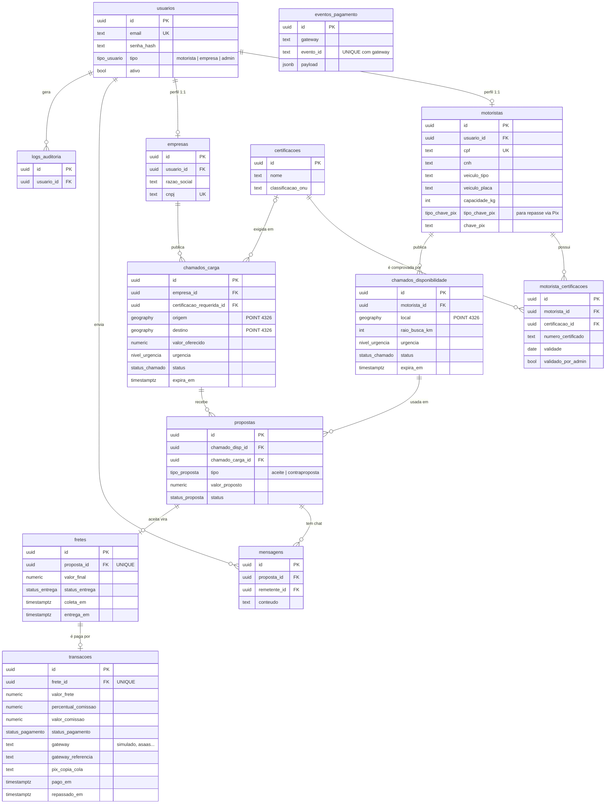

# Banco de dados — Backhaul

PostgreSQL 18 + PostGIS (hospedado no Neon). A fonte de verdade é `database/schema.sql`; este arquivo só explica o desenho. **Mudou o schema? Atualize os dois.**

## Diagrama (entidade-relacionamento)

## Como ler o desenho

- **Um usuário, um perfil.** `usuarios` guarda só login e tipo; os dados de negócio ficam em `motoristas` ou `empresas` (relação 1:1). Por isso o token JWT traz o id do *usuário* e as rotas buscam o id do *perfil* (`backend/src/perfis.ts`).
- **O motorista não aparece direto em `propostas`.** Ele vem pela disponibilidade usada na proposta (`propostas → chamados_disponibilidade → motoristas`). Isso amarra cada proposta a um "estou livre aqui, até tal hora".
- **A empresa também vem por um caminho:** `propostas → chamados_carga → empresas`.
- **Proposta aceita vira frete** (`fretes.proposta_id` é UNIQUE: uma proposta gera no máximo um frete). **Frete pago vira transação** (`transacoes.frete_id` é UNIQUE: um frete só é pago uma vez).
- **Geografia:** `local`, `origem` e `destino` são `GEOGRAPHY(POINT, 4326)`. A busca de cargas próximas usa `ST_DWithin` (usa o índice GiST) e ordena por `ST_Distance`.
- **Certificações:** `certificacoes` é o catálogo (MOPP etc.); `motorista_certificacoes` é o que cada motorista enviou, com validade e aprovação do admin. Carga que exige certificação só aparece e só aceita proposta de quem tem uma **aprovada e dentro da validade**.

## Valores dos ENUMs (sempre minúsculos, sem acento)

| Tipo | Valores |
|---|---|
| `tipo_usuario` | motorista, empresa, admin |
| `nivel_urgencia` | normal, urgente, critico |
| `status_chamado` (carga e disponibilidade) | aberto, em_negociacao, fechado, expirado, cancelado |
| `tipo_proposta` | aceite, contraproposta |
| `status_proposta` | pendente, aceita, recusada, expirada |
| `status_entrega` | aceito, em_transito, entregue, cancelado |
| `status_pagamento` | pendente, retido, liberado, estornado |
| `tipo_chave_pix` | cpf, cnpj, email, telefone, aleatoria |

## Caminho do dinheiro

`proposta aceita` → `frete (aceito)` → empresa paga → `transação (retido)` → motorista marca `em_transito` e depois `entregue` → `transação (liberado)`. A comissão da plataforma é 5% do valor do frete, calculada em centavos inteiros (ver `docs/decisoes-backend.md`).
