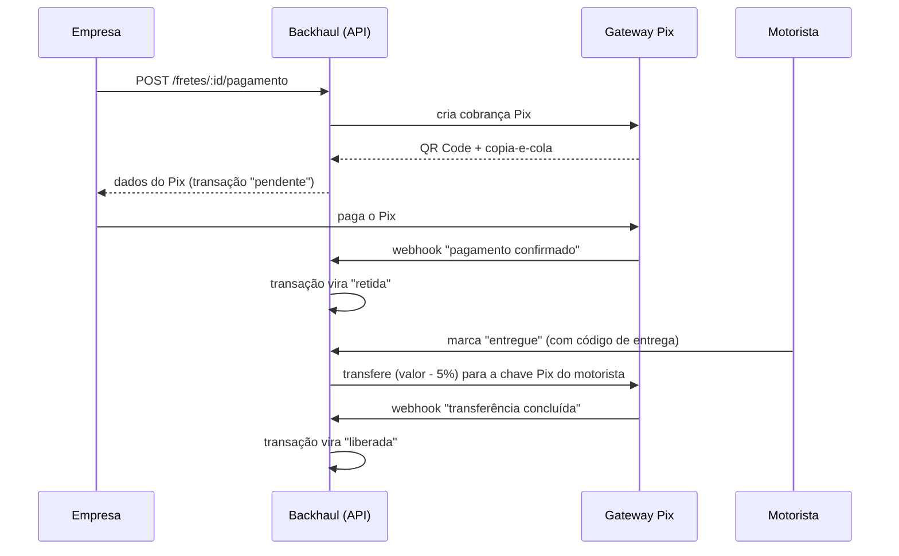

# Pagamentos — proposta de desenho (Pix)

> **Status: proposta.** Nada aqui está implementado ainda. Hoje o pagamento é simulado (`POST /fretes/:id/pagamento` só grava a transação). Este documento registra o que foi pesquisado e o que o grupo precisa decidir. Atualize-o conforme as decisões forem tomadas.

## Objetivo

O Backhaul pretende ser usado de verdade. O professor pediu pagamento real até **17/11/2026**. Para a entrega, o alvo é o fluxo completo **em ambiente de teste (sandbox)**. Para lançar de verdade, veja "Caminho para produção" no fim.

## Método: Pix

- **Empresa:** todo CNPJ tem Pix; pagamento imediato e comprovante automático.
- **Motorista:** autônomo recebe por Pix no dia a dia; saber que o frete já está pago antes de rodar é o maior atrativo.
- **Plataforma:** taxa menor que cartão (confira a tabela do gateway), sem dados de cartão no sistema e sem chargeback por contestação.
- **Fora do escopo agora:** cartão (taxa maior, chargeback, segurança de cartão) e boleto (demora a compensar, e o frete é urgente).

## Fluxo proposto

Estados da transação (o ENUM `status_pagamento` já existe): `pendente` → `retido` → `liberado`, e `estornado` para devoluções. Ponto a decidir: se `liberado` significa "motorista pediu a entrega" (como hoje) ou "transferência confirmada pelo gateway" (mais correto; exige o webhook de transferência).

## Gateway: Asaas (sandbox) primeiro, Mercado Pago como alternativa

Pesquisa feita em 07/11/2026 na documentação oficial. **O que foi confirmado e o que não foi:**

| Necessidade | Asaas | Mercado Pago |
|---|---|---|
| Cobrar por Pix e devolver QR Code | Sim (cobrança Pix) | Sim (`POST /v1/orders`, devolve `qr_code` e `qr_code_base64`) |
| Simular o pagamento no teste | Documentado **só por API**: duas contas sandbox, a pagadora paga o QR Code com `POST /v3/pix/qrCodes/pay`. Falta confirmar o caso de cobrança | A página não explica; há um guia "Realizar uma compra teste com Pix" que **não foi lido** |
| Pagar o motorista (transferência Pix por API) | Sim, `POST /v3/transfers` com chave Pix, e webhooks `TRANSFER_DONE`/`FAILED`/`CANCELLED`. Não foi confirmado como testar no sandbox, nem se há autorização extra | Não encontrado na documentação lida. O split exige OAuth de cada vendedor |
| Segurar o valor e liberar depois | Split é **imediato**, sem data futura. Opção: o valor fica na conta da plataforma e a transferência sai na entrega | Não confirmado (a página do split não trata de retenção) |
| Webhook | Sim | Sim; assinatura `x-signature` (HMAC). O cálculo exato não está na página lida |

**Por que Asaas primeiro:** cobrança Pix e transferência Pix no mesmo provedor permitem testar o ciclo completo (pagar, reter, repassar) sem o motorista ter conta no gateway. **Isso é uma hipótese a validar** com um teste real antes de escrever o código definitivo.

## Mudanças de dados previstas

Mudou o schema? Atualize `database/schema.sql` e este documento, e rode o SQL no Neon.

- `motoristas`: `chave_pix` e `tipo_chave_pix` (necessário para repassar).
- `transacoes`: `gateway`, `gateway_cobranca_id`, `gateway_repasse_id`, `pix_copia_cola`, `expira_em`, `pago_em`, `repassado_em`.
- Nova tabela `eventos_pagamento` com `UNIQUE (gateway, evento_id)`: guarda cada webhook recebido para não processar o mesmo aviso duas vezes.

## Confiabilidade e segurança

- **Webhook autenticado** (token ou assinatura do gateway) e **idempotente**.
- **Não confiar só no aviso:** ao receber um webhook, consultar a API do gateway e conferir valor e referência.
- **Reconciliação:** rotina que reconfere pagamentos pendentes, caso um aviso se perca.
- **Modo simulado por padrão:** variável `PAGAMENTOS_MODO` (`simulado` ou `sandbox`). Sem as chaves configuradas, tudo continua como hoje, e a demonstração nunca depende do gateway estar no ar.
- **Segredos** (chaves da API, token do webhook) **somente** nas variáveis de ambiente do Render, nunca no repositório.
- **Código de entrega (PIN):** hoje o motorista libera o pagamento sozinho ao marcar "entregue". Com dinheiro de verdade, a empresa precisa confirmar (código de 4 dígitos que a empresa recebe e o motorista digita).

## Contrato com o front (a combinar com o Pedro)

Ainda não vale como contrato. Previsto:

- `POST /fretes/:id/pagamento` passa a devolver os dados do Pix (QR Code e copia-e-cola) em vez de só a transação.
- `GET /fretes/:id/pagamento` para a tela acompanhar a confirmação.
- Tela da empresa com QR Code e estado "aguardando pagamento".
- Campo de chave Pix no cadastro e no perfil do motorista; campo do código de entrega.

## Caminho para produção

Itens que **não são código** e que o grupo precisa resolver antes de operar com dinheiro real. Nenhum deles foi validado por jurídico ou contador:

1. **CNPJ da Backhaul** e conta aprovada no gateway (a produção exige verificação da empresa).
2. **Custódia do dinheiro:** receber o valor da empresa e repassar depois é atividade regulada. Confirmar com advogado ou contador se o modelo "cobrar na conta da plataforma e transferir na entrega" é permitido, ou se é necessário um produto de marketplace do gateway.
3. **Regras do frete rodoviário** (por exemplo, pagamento eletrônico ao autônomo, registro na ANTT, piso mínimo de frete): verificar.
4. **Termos de uso e política de privacidade** (LGPD: o sistema guarda CPF, CNH e localização).
5. **Verificar o motorista de verdade:** CPF válido não prova identidade. A fila de aprovação de certificações é o início.
6. **Impostos e notas** sobre a comissão: com o contador.
7. **Operação:** limites de valor, alertas de falha de repasse, trilha de auditoria (`logs_auditoria`) e suporte para disputas.

## Fontes

- [Asaas: testar pagamento de QR Codes Pix](https://docs.asaas.com/docs/testar-pagamento-de-qrcodes-pix)
- [Asaas: transferência para outra instituição (Pix/TED)](https://docs.asaas.com/docs/transferencia-para-contas-de-outra-instituicao-pix-ted)
- [Asaas: FAQ do split](https://docs.asaas.com/docs/faq-do-split)
- [Mercado Pago: pagamento com Pix (Orders)](https://www.mercadopago.com.br/developers/pt/docs/checkout-api-orders/payment-integration/pix)
- [Mercado Pago: notificações (webhooks)](https://www.mercadopago.com.br/developers/pt/docs/checkout-pro-orders/notifications)
- [Mercado Pago: split de pagamentos 1:1](https://www.mercadopago.com.br/developers/pt/docs/split-payments/split-1-1/integration-configuration/integrate-marketplace)
